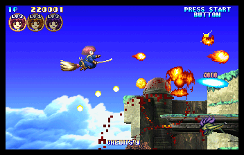
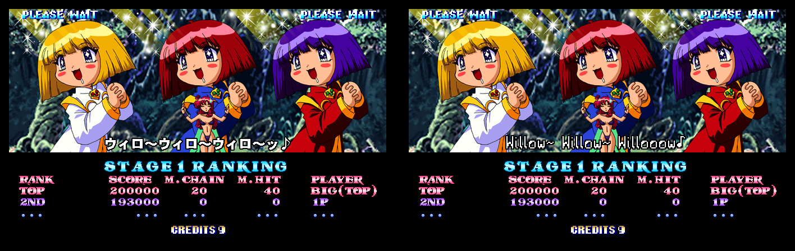
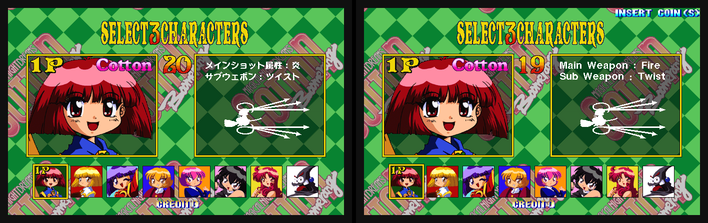
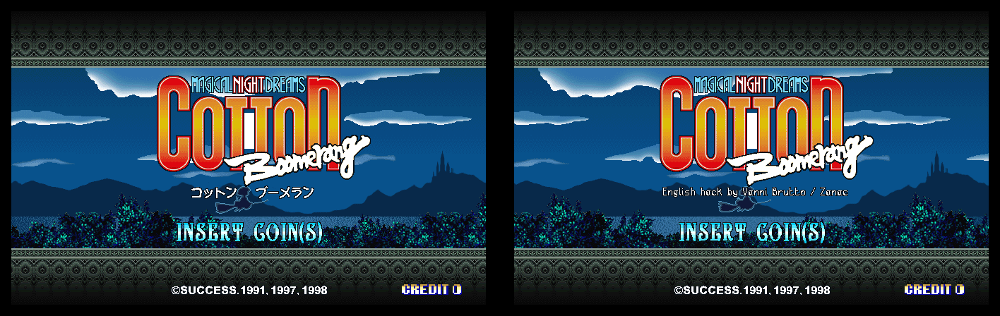
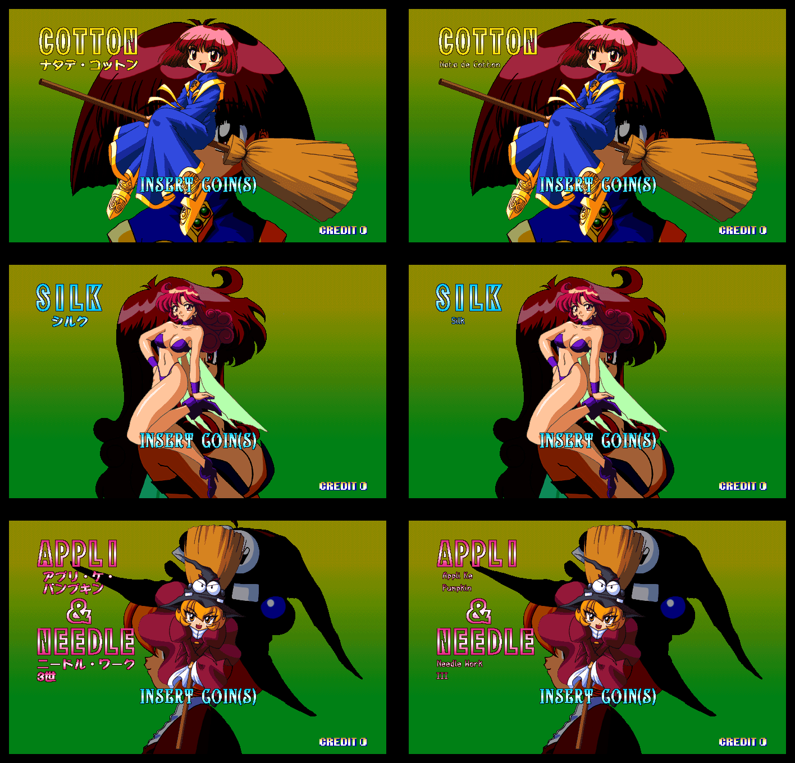
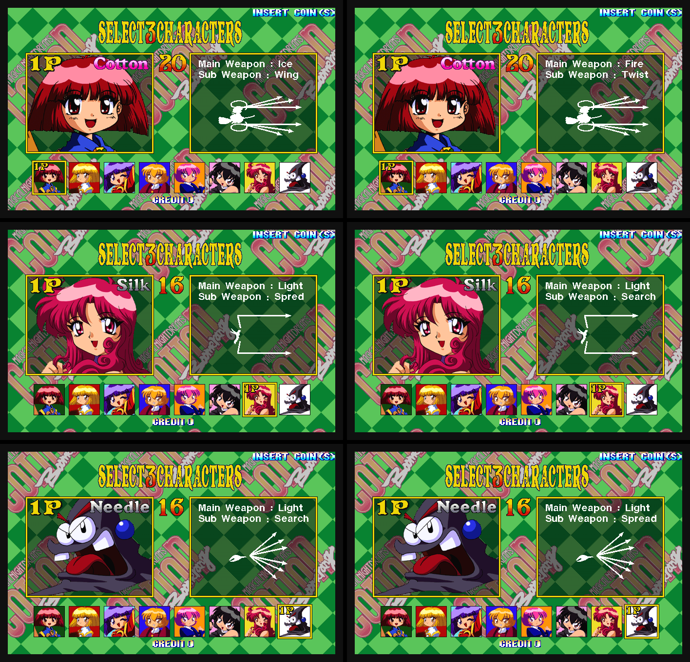
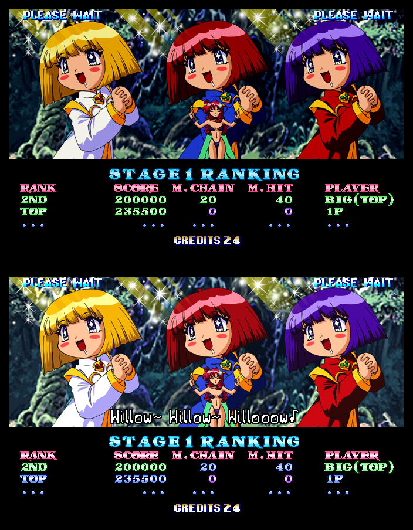
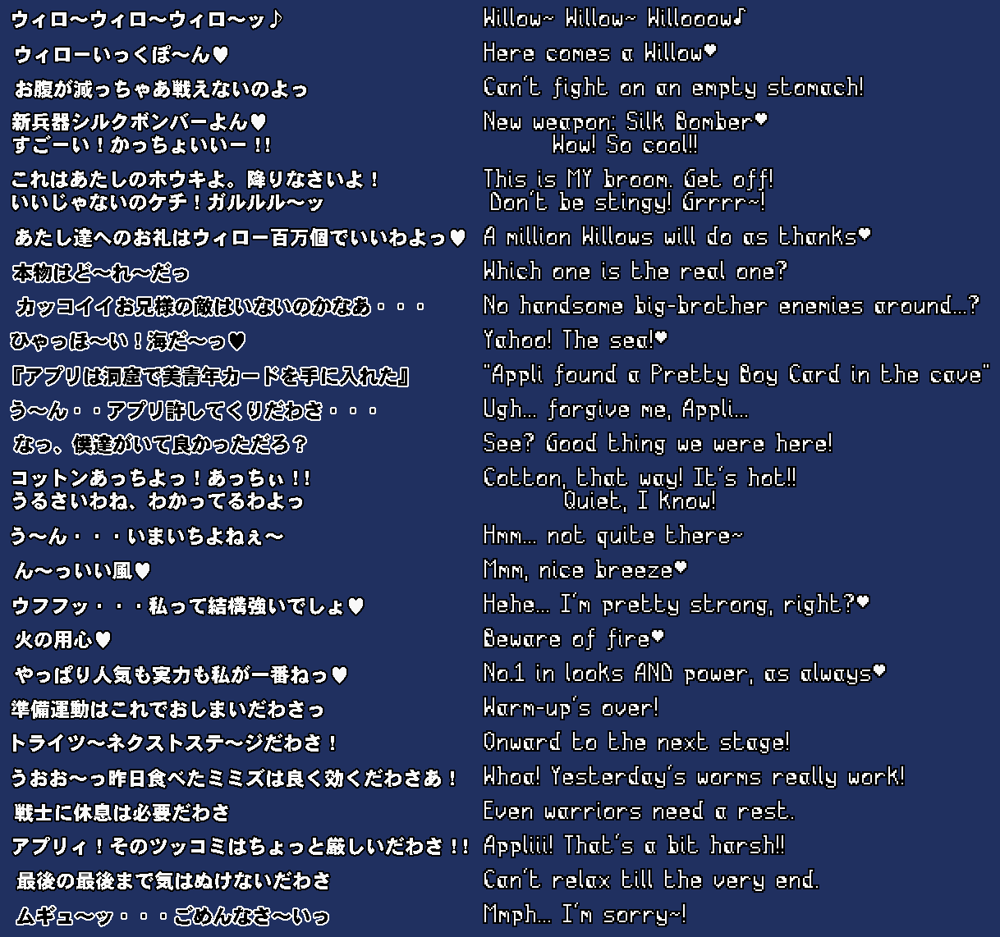
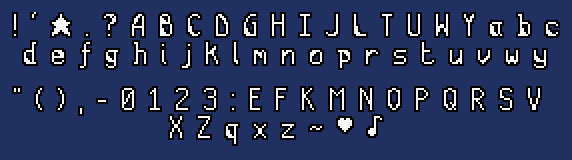

# Cotton Boomerang English (Sega ST-V)

An English translation of the ST-V arcade game *Cotton Boomerang*
(Success, 1998, MAME set `cottonbm`), as a bootleg clone set `cottonbme`
for [mame2003-plus](https://github.com/zanac/mame2003-plus-libretro)
(branch `stv-cottonbm-english`).

Most of the arcade game is already in English: menus, in-game messages,
ranking, staff roll and ending. The Japanese parts are the line a
character says on the stage result screen, the shot/weapon panels of the
character select screen, the katakana under the title logo and the full
names of the characters in the attract mode. There is no fan translation
of this game, so the lines are translated here and drawn with the English
font of the Cotton 2 Saturn fan translation, the same one the
[Cotton 2 English](https://github.com/zanac/Cotton2) arcade set uses.

With a non-Japanese BIOS (US, Europe, ...) the original game switches to
an export mode that drops the result lines and the full names, and shows
the select panels of the wrong character, one of them with the typo
"Spred". `cottonbme` always runs the game in its Japanese mode, which is
the translated one, so you get the same complete English game with every
BIOS.

## For dummies

You need two files you already have from your MAME/RetroArch ROM
collection: `cottonbm.zip` (Cotton Boomerang) and `stvbios.zip` (the ST-V
BIOS). This project does not give them to you.

1. Install Python 3 (Windows: [python.org](https://www.python.org/downloads/),
   tick "Add python.exe to PATH" during the setup; macOS and Linux usually
   have it already).
2. Download this project: green **Code** button on GitHub, **Download
   ZIP**, and unpack it. Or with git:
   ```
   git clone https://github.com/zanac/cottonbm
   ```
3. Put `cottonbm.zip` in the `cottonbm` folder you just unpacked (next to
   this README).
4. Open a terminal in that folder (Windows: type `cmd` in the address bar
   of the folder window and press Enter) and run:
   ```
   python3 patch/make_cottonbme.py .
   ```
   On Windows, if `python3` is not found, use `python` or `py` instead:
   ```
   py patch/make_cottonbme.py .
   ```
5. You get `cottonbme.zip` in the same folder, the full English ROM set
   (all the chips, it does not need `cottonbm.zip` any more). The script
   prints "written ... cottonbme.zip" and the CRC of every file.
6. Copy `cottonbme.zip` and `stvbios.zip` into your ROM folder and start
   `cottonbme` with the **mame2003-plus** core (RetroArch: Load Content,
   pick `cottonbme.zip`, choose "Arcade (MAME 2003-Plus)"). The core must
   be a build with the `cottonbme` entry (branch `stv-cottonbm-english`
   of [zanac/mame2003-plus-libretro](https://github.com/zanac/mame2003-plus-libretro)).

If the script says `cottonbm.zip not found`, the file is not in the folder
you gave it (the `.` means "this folder"); if it says a chip is not found,
your `cottonbm.zip` is a different dump: check it against the input table
below.

## Support
Hey dude! Help me out for a couple of :beers: or a :coffee:!<br/>
[](https://bmc.link/zanac)

## Status

| Part | State |
|---|---|
| Stage result screen: the 25 lines | English; stage 1 checked in the emulator, all lines checked as sprites (sheet below) |
| Character select: main shot and sub weapon panels | English, checked in the emulator for all 8 characters |
| Katakana under the title logo | removed (it only repeats the logo) |
| Character full names in the attract mode | English, checked in the emulator |
| Region: the game always runs in its Japanese (translated) mode | done, checked in MAME with `-bios jp` and `-bios us` |
| English panels of the export mode: wrong character, "Spred" | fixed as well, though the export mode is no longer used |
| ROM set `cottonbme` (complete, all chips), patch, driver entry | done |

What the BIOS region changes:

| | Original, Japanese BIOS | Original, other BIOS | `cottonbme`, any BIOS |
|---|---|---|---|
| Result line | Japanese | not shown | English |
| Select panels | Japanese | English, wrong character, "Spred" | English |
| Full names (attract) | katakana | not shown | English |
| Title katakana | shown | not shown | removed |

The BIOS itself still follows its region: its boot screens, warnings and
coin settings do not change.

Known limits:

- The result line is on screen for a short time; the lines were checked
  in the emulator for stage 1 only. The other 24 are built the same way
  and shown below as the cartridge holds them.

## Screenshots



*Stage 2 in `cottonbme`.*

Translated screens: Japanese arcade original on the left, `cottonbme` on
the right (mame2003-plus).

| | |
|---|---|
| Stage result screen |  |
| Character select |  |
| Title (the katakana under the logo) |  |
| Character full names (attract) |  |

With the US BIOS (`-bios us`), original game on the left, `cottonbme` on
the right. In the original every character gets the panel of another one
(here Cotton, Silk and Needle) and the "Spread" panel says "Spred":



The stage 1 result screen with the US BIOS, original game on top (the line
is skipped), `cottonbme` below (the line is there):



All the result lines, Japanese sprites of the cartridge on the left,
English sprites of `cottonbme` on the right:



The font, at the size used on the result screen: the letters of the
Cotton 2 English patch on top, the ones drawn for this game below.



## Getting the ROM set

You need `cottonbm.zip` (the MAME set) and `stvbios.zip`.

```
python3 patch/make_cottonbme.py ROMDIR [OUTDIR]
```

This writes `cottonbme.zip`. Python 3, standard library only. The script
checks every file it writes against the CRC32 in the patch.

`cottonbme.zip` is a complete set: it holds all seven chips, so it works
on its own (with `stvbios.zip`). `cottonbme` is still declared as a clone
of `cottonbm` in the driver, so the two sets sit together in a ROM list.

Input, the chips of `cottonbm.zip` (found by CRC, the names inside the zip
do not matter):

| File | Size | CRC32 | SHA1 |
|---|---|---|---|
| mpr21075.7 | 2097152 | 200b58ba | 6daad6d70a3a41172e8d9402af775c03e191232d |
| mpr21070.2 | 4194304 | 56c0bf1d | c2b564ce536c637bb723ed96683b27596e87ebe7 |
| mpr21071.3 | 4194304 | 2bb18df2 | e900adb94ad3f48be00a4ce33e915147dc6a8737 |
| mpr21072.4 | 4194304 | 7c7cb977 | 376dfb8014050605b00b6545520bd544768f5828 |
| mpr21073.5 | 4194304 | f2e5a5b7 | 9258d508ef6f6529efc4ad172fd29e69877a99eb |
| mpr21074.6 | 4194304 | 6a7e7a7b | a0b1e7a85e623b59886b28797281df1d65b8a5aa |
| mpr21069.1 | 4194304 | 6a28e3c5 | 60454b71db49b872e0cb89fae2259fed601588bd |

Output, the files of `cottonbme.zip`:

| File | Size | CRC32 | SHA1 | From |
|---|---|---|---|---|
| cbe21075.7 | 2097152 | 67304902 | fa74af1216f5f36656c138851e03a1f9ac2aa016 | mpr21075.7, changed |
| cbe21070.2 | 4194304 | 6911739c | 2c12e5705268caf9ae29d1fe4ae1b3021a4ee172 | mpr21070.2, changed |
| mpr21071.3 | 4194304 | 2bb18df2 | e900adb94ad3f48be00a4ce33e915147dc6a8737 | copied |
| mpr21072.4 | 4194304 | 7c7cb977 | 376dfb8014050605b00b6545520bd544768f5828 | copied |
| cbe21073.5 | 4194304 | a93744a2 | 1bbc5befefea90d41991cce30f985f94240a20d6 | mpr21073.5, changed |
| mpr21074.6 | 4194304 | 6a7e7a7b | a0b1e7a85e623b59886b28797281df1d65b8a5aa | copied |
| cbe21069.1 | 4194304 | cc3b4a22 | 79012e86e8a784a7268289b1082d79714b86f79d | mpr21069.1, changed |

These names and CRCs are the ones the `cottonbme` driver entry in
mame2003-plus expects. To check the set in MAME 0.264 instead, rename the
`cbe` files to `mpr` in a copy of `cottonbm.zip` and start `cottonbm`
(`-bios jp` or `-bios us`).

## Rebuilding everything

`build.py` redoes the whole job from the original ROM set and writes both
the ROM set and `patch/cottonbme.dat`:

```
python3 build.py ROMDIR [OUTDIR]
```

- `ROMDIR`: folder with `cottonbm.zip`
- `OUTDIR`: output folder (default `./out`)

The English text is `text/result_lines.txt`, the font
`font/cotton2_hint_font.json`. The result is reproducible byte for byte.

| File | Purpose |
|---|---|
| `build.py` | the whole build |
| `patch/make_cottonbme.py` | ROM set from `cottonbm.zip` and `cottonbme.dat` |
| `text/result_lines.txt` | frames, Japanese and English of every result line |
| `font/cotton2_hint_font.json` | the font: one 16-row bitmap per letter |
| `tools/translate.py` | the English cartridge: region, result lines, select panels, title, names |
| `tools/font.py` | draws a line with the font (outline; 2x or 1x) |
| `tools/lz.py` | LZ00 compressor |
| `tools/romset.py` | ROM names and patch format |
| `tools/cblib.py` | cartridge, file chain, MF containers, LZ00 decoder |
| `tools/make_font.py` | rebuilds the font from `cotton2e.zip` |
| `tools/font_hints.py` | the text of the Cotton 2 hints the font is cut from |
| `tools/font_extra.py` | the letters drawn for this game |
| `tools/screens.py` | the line and font sheets of this README (needs Pillow) |

The font file is versioned, so the build does not need Cotton 2. To make
it again, build `cotton2e.zip` with
[zanac/Cotton2](https://github.com/zanac/Cotton2) and run
`python3 tools/make_font.py cotton2e.zip`.

## Technical notes

### Cartridge

`mpr21075.7` is loaded at 0x200000 (2 MB); `mpr21070.2` … `mpr21069.1`
follow at 4 MB steps (`ROM_LOAD16_WORD_SWAP`), up to 0x1c00000. The file
system is the one of Cotton 2: chained entries of size (4), name (16),
size2 at +0x14, an 8-byte stamp and the data from +0x20. The chain ends at
0x185b348; the rest of the region is zeros and is used for the new
sprites (from 0x185c000).

### MF containers and sprites

As in Cotton 2: an MF file is a chain of subfiles (`SCH` frames, `SPT`
sprite patterns, `SPL` palettes, `SAN` animations, `SIF` counts, `SCP`
cells). A frame record is 20 bytes: the sprite offset from the start of
the `SPT` (32-bit), the palette bank (16-bit), then x and y (signed
16-bit). A sprite is a 0x20-byte header (width at +4, height at +6, data
size at +8) and the data.

Unlike Cotton 2, the arcade sprites of this game are compressed with
LZ00: `LZ00`, the 32-bit unpacked size, then

- byte `b < 0x10`: copy the next `b + 1` bytes
- byte `b >= 0x10`: copy `next + 3` bytes from `b - 0x0f` bytes back

The size field of the header is the size of the compressed data.
`tools/lz.py` compresses the new sprites in the same format.

### Stage result lines

The lines are frames 80–137 of `CHR_RS.MF`, two frames per line (the line
is wider than one sprite). The first frame is the left part and ends at
the frame anchor, the second one starts there: the x of a frame is the
offset of its centre from the anchor. One-line sprites are 32 pixels high,
the three two-line exchanges 56. The text uses two colours, 1 (outline)
and 2 (fill), in palette banks 6, 7 or 8 (black on white or white on
black, by character).

The result screen runs in the high resolution mode (704 pixels wide), so
the Cotton 2 font, made for 352 pixels, is drawn at twice its size: a
letter is a 1-pixel stroke on a 16-row cell, the outline is added around
it and the line is scaled 2x, which gives 32-pixel lines like the
Japanese ones. Two-line exchanges have a 14-row line pitch (60 pixels).

For every line, `tools/translate.py` draws the English text, centres it
where the Japanese line was centred, cuts it in two at a multiple of 8,
compresses both parts and puts them in the free space after the file
chain. The two frames point there (an offset past the end of the `SPT`)
and get the new x, and a y that keeps the bottom edge of the line. The
container itself does not change size and nothing else moves.

### Region

The main program is at 0x200000 of the cartridge (in `mpr21075.7`) and
runs from 0x0600f000. At start the game reads the area code the BIOS
leaves at 0x06000248 (bits 12–15: 1 Japan, 4 USA, ...) and keeps its own
copy at 0x06043884: 0 for Japan, the area code otherwise. Everything the
game does by region (result lines, full names, title katakana, select
panels) follows that copy.

```
0602244c  mov.l @r7,r4      ; r7 = 0x06000248
0602244e  shlr8 r4          ; area code: bits 12-15
06022450  shlr2 r4
06022452  shlr2 r4
06022454  and   r6,r4       ; r6 = 15
06022456  mov   r4,r0
06022458  cmp/eq #1,r0
0602245a  bf    06022460    ; not Japan: keep the area code
0602245c  bra   0602246c
0602245e  mov   #0,r0       ; Japan: 0
...
0602246c  mov.b r0,@(4,r5)  ; r5 = 0x06043880
```

The `bf` (cartridge offset 0x21345a) becomes a `nop`, so the game always
takes the Japanese branch. The area code itself is not changed, so the
BIOS (coin settings, boot screens) keeps working by its real region.

### Character select panels

`CHR_SEL.MF` has the shot/weapon panels twice: Japanese in frames 56–59
and 64–67, English in frames 72–79, in the same order and at the same
position:

| Panel | Japanese frame | English frame |
|---|---|---|
| Fire / Twist | 56 | 72 |
| Wind / Focus | 57 | 73 |
| Ice / Sector | 58 | 74 |
| Light / Search | 59 | 75 |
| Ice / Wing | 64 | 76 |
| Wind / Homing | 65 | 77 |
| Fire / Pierce | 66 | 78 |
| Light / Spread | 67 | 79 ("Spred") |

In Japanese mode the game shows the right Japanese panel. In export mode
it shows the English frame 4 places away (character 0, Cotton, gets frame
76, "Ice / Wing", instead of 72): a bug of the original game, seen in MAME
with `-bios us`.

Here the Japanese frames point at the English sprites. The English frames
are fixed as well, even though `cottonbme` no longer uses the export mode:
they point at the sprite 4 places back, so each character would get its
own panel. Frame 79 also gets a new sprite: the same panel
with an "a" put between the "e" and the "d" of "Spred". The "a" is cut
from "Weapon" in the same line, so it is the game's own letter; the panel
text is colour 1, the background a checkerboard of colours 0 and 2.

### Title and character names

Under the logo of the title screen the Japanese mode shows
"コットン ブーメラン" (*Cotton Boomerang*, frame 6 of `CHR_STT.MF` and of
`CHR_TTLB.MF`, the same 176x24 sprite). It is the title the logo already
shows in English, so it becomes an empty sprite.

In the attract mode every character has a big English name (COTTON, SILK,
APPLI & NEEDLE) and, in the Japanese mode only, the full name in katakana
below it (`CHR_TTLA.MF`):

| Frame | Katakana | English |
|---|---|---|
| 18 | ナタデ・コットン | Nata de Cotton |
| 38 | シルク | Silk |
| 26 | アプリ・ケ・パンプキン | Appli Ke / Pumpkin |
| 27 | ニードル・ワーク 3世 | Needle Work / III |

The new sprites have the same size and palette: every katakana line is
replaced by the English line drawn with the font at its normal size, left
aligned where the katakana started. The outline is colour 15 like the
katakana; the fill of every row takes the colour the katakana have in
that row, so the gradient of the original stays (yellow for Cotton, blue
for Silk, pink for Appli and Needle). The "&" in frame 26 stays.

### Font

The English letters of Cotton 2 come from the continue screen hints of
`cotton2e`, sentences drawn with the font of the Saturn patch. With their
text (`tools/font_hints.py`) every line is cut into letters: the stroke
pixels (values 3 and 4) joined in 8 directions, pieces that overlap in x
merged (the dot of i, j); the count of pieces matches the letters of every
line. The most common drawing of each letter is kept; letters are 3
pixels apart, a space is 9. The hints have no E, F, K, M, N, O, P, Q, R,
S, V, X, Z, q, x, z, digits and some punctuation: those are drawn in the
same style (`tools/font_extra.py`), with the ♥ and ♪ of the Japanese
lines.

## Credits and license

- Translation and the arcade port: Zanac (Vanni Brutto).
- English font: from the
  [Cotton 2 Saturn English patch](https://segaxtreme.net/resources/cotton-2-english-patch.84/)
  (translation and hacking: nanashi; proofreading and editing: Katrin,
  Danthrax). The patch is distributed under CC BY-NC-SA 4.0
  (`font/LICENSE-CC-BY-NC-SA-4.0.txt`); the font here, its derived
  letters and the patch of this project follow the same license: credit
  the authors, no commercial use, share alike.
- Cartridge tools: from [zanac/Cotton2](https://github.com/zanac/Cotton2).
- *Cotton Boomerang* © Success 1998. This project distributes no game
  data: the patch only holds the differences from the original chips,
  and the unchanged chips are copied from your own `cottonbm.zip`.
